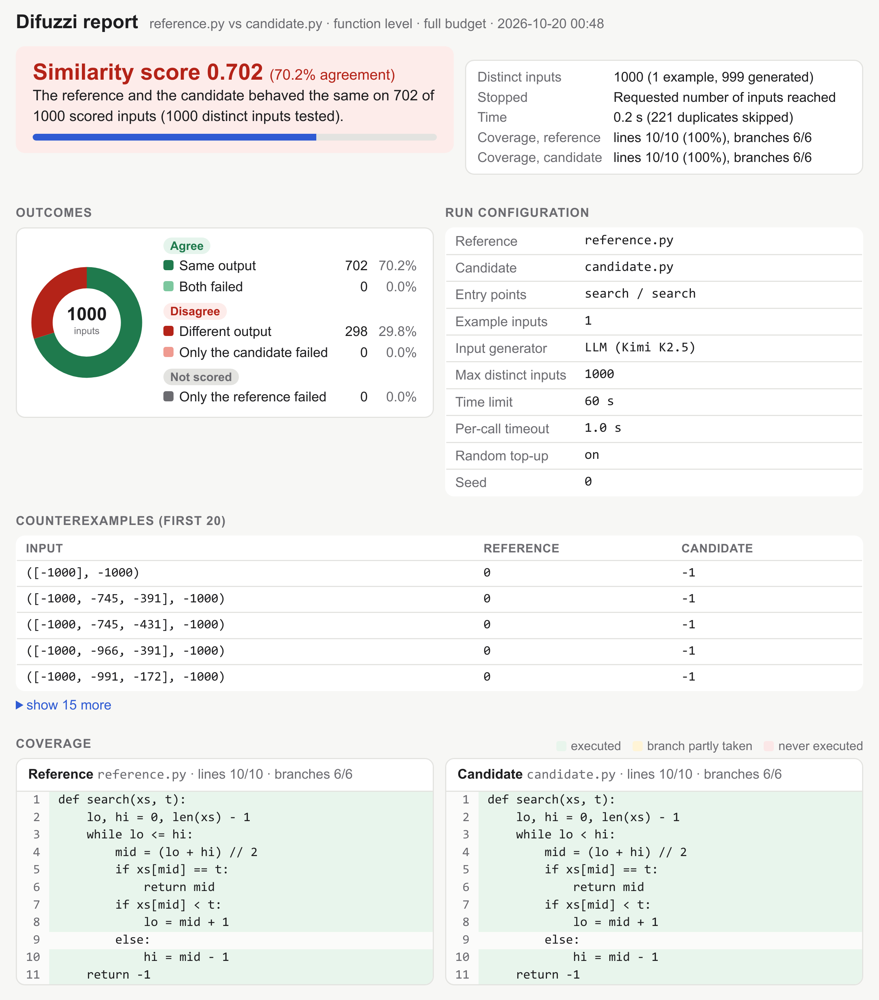
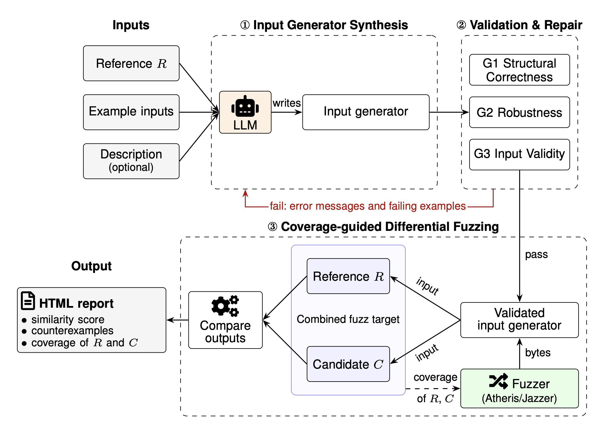

# 🔍 DIFUZZI: A Differential Fuzzing Tool for Code Functional Similarity Assessment

**Difuzzi** is a differential fuzzing tool that estimates functional similarity between a reference program and one or more candidate implementations in Python or Java. It uses an LLM to synthesize input generators, validates them through automated checks, and employs coverage-guided fuzzing (Atheris for Python and Jazzer for Java) to compare program behavior.

Difuzzi produces an interactive HTML report with **functional similarity scores**, **counterexamples**, and **line and branch coverage** of both the reference and the candidate.

# 📁 Repository structure

```text
difuzzi/     the tool: command line, input-generator synthesis and checks, Python and Java fuzzing, report
examples/    ready-to-run examples (Python and Java, function and file level)
docs/        figures used in this README
Dockerfile   builds the Docker image
run.sh       runs a bundled example through Docker
```

# Part 1: Run locally

## 📦 1. Install

Needs Python 3.12 or newer on Linux or macOS. For Java programs you also need a **JDK 17** (`java` and `javac` on the `PATH`). On macOS, Atheris (the Python fuzzer) needs a clang with libFuzzer, which Apple's clang does not include.

The easiest way to get all of this is [conda](https://docs.conda.io/en/latest/miniconda.html):

```bash
conda create -n difuzzi --override-channels -c conda-forge python=3.12 openjdk=17 clangxx compiler-rt
conda activate difuzzi
export CLANG_BIN=$CONDA_PREFIX/bin/clang   # lets Atheris build (needed on macOS)

git clone https://github.com/Dristi123/difuzzi.git
cd difuzzi
pip install .
```

> **Tip:** if the install is difficult on your machine, use [Docker](#-part-2-run-in-docker) instead: it includes everything.

## 🎮 2. Try the interactive demo

No LLM key needed: the bundled examples ship with their input generators.

```bash
difuzzi-demo        # menu of 8 examples (Python and Java); type a number
difuzzi-demo 1      # or run example 1 directly
difuzzi-demo --all  # run all of them
```

Example 1 compares a correct binary search with a buggy one (`while lo < hi` instead of `while lo <= hi`):

```text
Agreement:        70.20%  (702/1000 scored inputs)
Distinct inputs:  1000  (1 example input(s), 999 generated; 221 duplicates skipped)
Stopped:          Requested number of inputs reached after 0.1 s
Coverage reference:   lines 10/10, branches 6/6
Coverage candidate:   lines 10/10, branches 6/6
Counterexample:   input ([-1000], -1000)
                  reference -> 0
                  candidate -> -1
Report:           difuzzi-demo-out/example1/report.html
```

- **Agreement:** the similarity score, i.e. the share of inputs on which the candidate behaves like the reference.
- **Counterexample:** an input on which they differ.
- **Coverage:** how much of each program the inputs executed.
- **Report:** an HTML page with all of this. Open it in a browser, e.g. `open difuzzi-demo-out/example1/report.html`.



## 🚀 3. Run on your own programs

**Files you need:**

- `reference.py` and `candidate.py` (both `.py` or both `.java`), defining the same function.
- `examples.txt`: one valid input for the reference, as one line, e.g. `([1, 3, 5, 7, 9], 7)` for `search(xs, t)` (Java: a Java expression such as `new int[]{3, 1, 2}`).
- `description.txt` (optional): a natural-language description of what the reference does.

**Set an API key and a model:** an LLM writes the input generator once (it is cached and reused for every candidate). The model name picks the provider.

> **Supported models:** Difuzzi currently supports Kimi and Gemini models. Other models are rejected with an error. Any active Kimi or Gemini model name should work; the ones below are examples. If you set no model, `Kimi K2.5` is used.

| Model name starts with | Provider | Example model |
|---|---|---|
| `kimi` | Kimi (Moonshot AI) | `kimi-k2.5` |
| `gemini` | Google Gemini | `gemini-3.8-flash` |

```bash
export DIFUZZI_LLM_API_KEY=your-key
export DIFUZZI_LLM_MODEL=your-model   # a Kimi or Gemini model name, see the table above
```

**Run:**

```bash
difuzzi reference.py candidate.py --examples examples.txt --description description.txt
```

The report is written to `difuzzi-out/report.html`.

**Several candidates:** give a folder instead of a file. Every file in it is compared with the reference, using the same input generator, and `difuzzi-out/summary.html` ranks them.

```bash
difuzzi reference.py candidates/ --examples examples.txt --description description.txt
```

# Part 2: Run in Docker

The image includes Python and Java (JDK 17, Jazzer, JaCoCo, ASM), and keeps the programs under test isolated from your machine.

> **Apple Silicon (M1/M2/M3/M4):** add `--platform linux/amd64` to `docker build` and every `docker run`.

## 🛠️ 1. Build

```bash
git clone https://github.com/Dristi123/difuzzi.git
cd difuzzi
docker build -t difuzzi .
```

## 🎮 2. Try the interactive demo

```bash
docker run --rm -it --user "$(id -u):$(id -g)" -v "$PWD":/work \
    --entrypoint difuzzi-demo difuzzi
```

Reports are written to `./difuzzi-demo-out/` on your machine. A container cannot open a browser, so open them yourself, e.g. `open difuzzi-demo-out/example1/report.html`.

## 🚀 3. Run on your own programs

Put your files in the current folder (see the files you need in Part 1, step 3), then:

```bash
export DIFUZZI_LLM_API_KEY=your-key
export DIFUZZI_LLM_MODEL=your-model   # a Kimi or Gemini model name, see Part 1, step 3

docker run --rm --user "$(id -u):$(id -g)" -v "$PWD":/work \
    -e DIFUZZI_LLM_API_KEY -e DIFUZZI_LLM_MODEL \
    difuzzi reference.py candidate.py --examples examples.txt --description description.txt
```

For several candidates, replace `candidate.py` with the folder. The report is written to `difuzzi-out/`.

[`run.sh`](run.sh) runs a bundled example this way (export the key and model, then `./run.sh`).

# ⚙️ Command-line options

```text
difuzzi R C --examples FILE [options]
```

`R` is the reference and `C` the candidate: a `.py` or `.java` file, or a folder of candidates.

> **Required:** `--examples`, with at least one example input.

| Option | Meaning | Default |
|---|---|---|
| `--examples FILE [FILE ...]` | Example inputs. Function level: a file with one argument tuple per line (`#` lines are ignored). File level: files, or a folder of `.txt` files, each holding one standard input | **required** |
| `--description TEXT_OR_FILE` | What R does, as text or a file. Helps the LLM write valid inputs | none |
| `--llm MODEL` | Model that writes the input generator (Kimi or Gemini) | `Kimi K2.5` (or `$DIFUZZI_LLM_MODEL`, if set) |
| `--level {function,file}` | `function`: compare a function's return values. `file`: compare the standard output of whole programs | `function` |
| `--early-stop` | Stop at the first input where R and C differ and report equivalent / not equivalent, instead of a score | off |
| `--entry ENTRY` | Function to compare in R (and in C, unless `--entry-b` is given) | first function in R |
| `--entry-b ENTRY_B` | Function to compare in C, if its name differs | same as `--entry` |
| `--max-cases N` | Number of distinct inputs to run | `1000` |
| `--time SECONDS` | Time limit for the whole run | `60` |
| `--call-timeout SECONDS` | Time limit for one call of R or C; a slower call counts as a failure | `1` |
| `--seed SEED` | Random seed of the fuzzer (same seed, repeatable run) | `0` |
| `--no-topup` | Use only coverage-guided inputs: stop when coverage stops growing, instead of topping up with random ones | off |
| `-o, --out DIR` | Folder for the report and results | `difuzzi-out` |
| `-h, --help` | Show the help | |

**Exit codes:** `0` done, `1` a program could not be run, `2` usage error, `3` counterexample found with `--early-stop`.

**Environment variables:** `DIFUZZI_LLM_API_KEY`, `DIFUZZI_LLM_MODEL`, and `DIFUZZI_CACHE` (where generators are cached, default `~/.cache/difuzzi`).

# 🧠 How it works



1. **Input generator synthesis:** from the reference, an example input and a description, an LLM writes a small function that turns the fuzzer's random bytes into valid inputs. It is written once and reused for every candidate.
2. **Validation and repair:** the generator must compile, always produce an input, and produce only inputs the reference accepts. If a check fails, the problems go back to the LLM.
3. **Coverage-guided differential fuzzing:** Atheris (Python) or Jazzer (Java) mutate the bytes to cover new lines and branches, and both programs run on every distinct input.

The **similarity score** is the share of inputs on which the candidate agrees with the reference (same output, or both fail).

# 📄 License

MIT, see [`LICENSE`](LICENSE).
